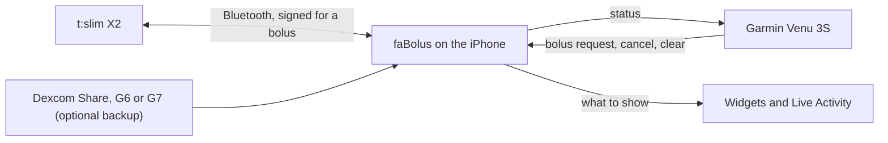

# How it works

A plain-language picture of who talks to whom. The developer version is
[ARCHITECTURE.md](https://github.com/faBolus-app/faBolus/blob/main/ARCHITECTURE.md).

## The phone owns the pump

- **The iPhone is the only thing that talks to the pump.** It keeps the Bluetooth link up, reads the
  pump's status, and is the only place a bolus is sent from.
- **The watch is a remote.** It shows what the phone sends it and asks the phone to bolus, cancel or
  clear an alert. The phone checks every request before anything reaches the pump. Garmin's own
  Garmin Connect app carries the messages between the watch and the phone.
- **Widgets only show.** They display what the app last published, with its age, and open the app when
  tapped. **The Live Activity is a remote** too, when allowed: its buttons ask the phone to bolus, cancel
  or clear an alert, and the phone checks every request as it checks the watch's.

## Where glucose comes from

The pump receives your CGM's readings and faBolus reads them from the pump. If you set up a
[backup CGM](setup/cgm.md), faBolus uses it only while the pump's own reading is old or missing, and
marks where a reading came from.

Every value carries the time it was measured. That's what "1 min ago" means everywhere in the app, and
what decides when a value is too old to show as current.

## Pairing and signing

Pairing with the code your pump shows gives faBolus a key that only it and your pump share. Every bolus
and cancel is signed with that key, and the pump ignores commands that aren't. The pairing is stored on
the phone, so faBolus reconnects on its own after that.

## Bolus outcomes

faBolus keeps a record of every bolus it sends, on the phone. Each one ends as delivered, stopped
(less than asked was delivered), refused by the pump, or failed. If the link drops at the wrong moment
the outcome is unknown until the pump's history settles it, and until then no new bolus can start.
See [Safety](safety.md#when-an-outcome-is-unknown).

## The three projects

- **faBolus**: the iPhone app, its widgets and Live Activity, and the message format the watch speaks.
- **TandemKit**: the library that speaks the pump's protocol. Every message it builds is checked byte for
  byte against pumpX2, the reverse-engineering it's ported from. The app build downloads it for you.
- **faBolusGarmin**: the watch app. It speaks the same message format and is built separately.
