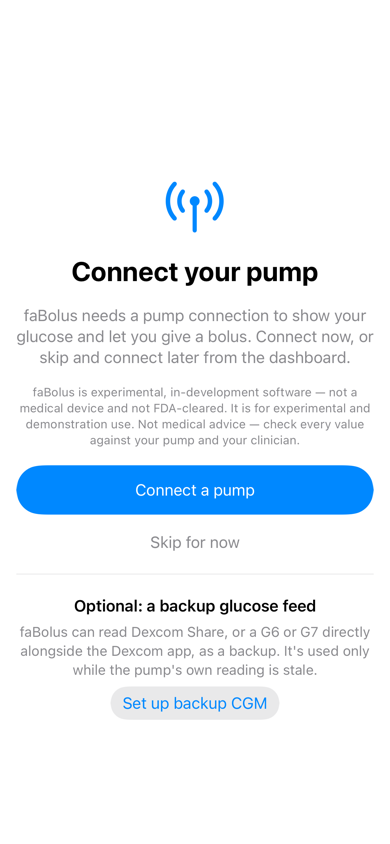

# 3 · Put the app on your iPhone

You'll download the code, give it your details, make the Xcode project, and press **Run**.

The guide keeps everything in one folder, **Developer** in your home folder:

```text
Developer/
├── faBolus/
│   ├── faBolus/          the app (this step)
│   └── faBolusGarmin/    the watch app (step 4, optional)
└── vendor/
    └── connectiq-companion-app-sdk-ios-1.8.0/   Garmin's SDK (optional, below)
```

Keep these names and places. The project looks for Garmin's SDK at exactly that spot, two folders up
from the app.

## Step 1: Download the code {#download}

<ol class="cx2-steps">
<li>In Finder, choose <strong>Go → Home</strong>. If there's no <strong>Developer</strong> folder, make one (<strong>File → New Folder</strong>). Inside it, make a folder named <strong>faBolus</strong>.</li>
<li>Open <strong>GitHub Desktop</strong> and choose <strong>File → Clone Repository…</strong>, then the <strong>URL</strong> tab.</li>
<li>For the URL, paste <code>https://github.com/faBolus-app/faBolus</code>.</li>
<li>Click <strong>Choose…</strong> next to <strong>Local Path</strong> and pick the <strong>Developer/faBolus</strong> folder you made. Check that the Local Path now ends in <code>Developer/faBolus/faBolus</code>; type it in if it doesn't.</li>
<li>Click <strong>Clone</strong> and wait for it to finish.</li>
</ol>

<div class="cx2-check" markdown>
**Success looks like:** **Developer → faBolus → faBolus** holds the code, with files such as
`project.yml` and a `scripts` folder.
</div>

You don't download TandemKit, the pump library: Xcode fetches the exact version the app needs when you
open the project.

## Step 2: Garmin's SDK (only for the watch) {#garmin-sdk}

**Skip this step if you won't use a Garmin watch.** The app then builds without watch support, and its
**Settings → Watch** screen says so. You can add the SDK later and build again.

The phone app needs Garmin's **Connect IQ companion SDK for iOS**, version **1.8.0**, to talk to the
watch. Garmin licenses it separately, so it isn't in the repository.

<ol class="cx2-steps">
<li>Download <a href="https://github.com/garmin/connectiq-companion-app-sdk-ios/archive/refs/tags/1.8.0.zip">connectiq-companion-app-sdk-ios-1.8.0.zip</a> from Garmin's GitHub page. Downloading it accepts Garmin's license, which its README links to.</li>
<li>In <strong>Downloads</strong>, double-click the zip if it wasn't unzipped already. You get a folder named <code>connectiq-companion-app-sdk-ios-1.8.0</code>.</li>
<li>In your <strong>Developer</strong> folder, make a folder named <strong>vendor</strong>, and drag the Garmin folder into it. Don't rename it.</li>
</ol>

<div class="cx2-check" markdown>
**Success looks like:** **Developer → vendor → connectiq-companion-app-sdk-ios-1.8.0** contains
`ConnectIQ.xcframework` and `Package.swift`.
</div>

## Step 3: Your details {#your-details}

Apple needs two things from you: a **bundle ID** that's unique to you, and your **team**. They go in a
file named `LocalConfig.xcconfig`, which stays on your Mac and is never uploaded.

Open **Terminal** and run these three commands, one at a time. The first moves into the app's folder,
the second makes your settings file from the example, and the third opens it in TextEdit.

```sh
cd ~/Developer/faBolus/faBolus
cp LocalConfig.xcconfig.example LocalConfig.xcconfig
open -e LocalConfig.xcconfig
```

In TextEdit, change two lines:

- **`APP_BUNDLE_ID`**: a name only you use, written like a reversed web address, for example
  `com.janesmith.fabolus`. Every App ID must be unique across Apple, so the project's own
  `com.fabolus.app` won't work for your account. The widgets and the shared App Group are named from
  it automatically.
- **`DEVELOPMENT_TEAM`**: your 10-character Team ID (see below), or nothing after the `=` if you'd
  rather pick your team in Xcode. Don't leave the example's `ABCDE12345`.

Save (<kbd>⌘</kbd> + <kbd>S</kbd>) and close TextEdit.

??? note "Finding your Team ID"
    - **Paid account:** sign in at [developer.apple.com/account](https://developer.apple.com/account)
      and open **Membership details**. The Team ID is listed there.
    - **Free account:** first make your signing certificate. In Xcode choose **Xcode → Settings… →
      Accounts**, select your Apple account, select your team, click **Manage Certificates…**, then
      **+** → **Apple Development**, and close the window. Then run this in Terminal:

        ```sh
        security find-certificate -c "Apple Development" -p | openssl x509 -noout -subject
        ```

        Your Team ID is the 10 characters after `OU=`.

    With the Team ID in the file, the team is set every time the project is made. Without it, you pick
    the team in Xcode (Step 6) after each time you make the project.

## Step 4: Make the Xcode project

Still in Terminal, in the same folder, run:

```sh
./scripts/generate-project.sh
```

<div class="cx2-check" markdown>
**Success looks like:** `Generated faBolus.xcodeproj (Garmin: on)`, or `(Garmin: off)` if you skipped
Step 2. A **faBolus.xcodeproj** file now sits in the folder.
</div>

If it says `xcodegen: command not found`, go back to
[Install Homebrew and XcodeGen](xcode.md#step-3-install-homebrew-and-xcodegen), then run it again.

??? note "Paid account: let notifications break through Focus"
    A paid account can give the bolus result, "pump disconnected" and the backup urgent low the Time
    Sensitive level, so they come through a Focus. Make the project this way instead:

    ```sh
    FABOLUS_TIME_SENSITIVE=1 ./scripts/generate-project.sh
    ```

    Use the same command whenever you make the project again. A free account can't sign this
    capability; without it those notifications arrive as normal ones.

## Step 5: Open the project

```sh
open faBolus.xcodeproj
```

Xcode opens. Near the top it says it's resolving packages: it's downloading TandemKit and the other
libraries the app uses. The first time this takes a few minutes. Wait until it finishes.

## Step 6: Check signing

<ol class="cx2-steps">
<li>In the left panel, click the blue <strong>faBolus</strong> project icon at the top.</li>
<li>Under <strong>TARGETS</strong>, click <strong>faBolus</strong>, then the <strong>Signing &amp; Capabilities</strong> tab.</li>
<li>Check that <strong>Automatically manage signing</strong> is ticked and <strong>Team</strong> shows your team. If it shows none, pick your team.</li>
<li>Do the same for the <strong>faBolusWidgets</strong> target.</li>
</ol>

There's a third target, **faBolusAppTests**. It isn't installed on the phone and needs no team.

## Step 7: Turn on Developer Mode on the iPhone

<ol class="cx2-steps">
<li>Connect the iPhone to the Mac with a cable. When the phone asks <strong>Trust This Computer?</strong>, tap <strong>Trust</strong> and enter your passcode.</li>
<li>On the iPhone, open <strong>Settings → Privacy &amp; Security</strong>, scroll down to <strong>Developer Mode</strong> and turn it on.</li>
<li>Tap <strong>Restart</strong>. After the phone restarts, tap <strong>Turn On</strong> and enter your passcode.</li>
</ol>

!!! note "No Developer Mode switch?"
    It appears only after the phone has been connected to a Mac running Xcode. Keep the cable in, choose
    your iPhone in Xcode as in Step 8, then look again.

## Step 8: Run

<ol class="cx2-steps">
<li>At the top of Xcode, check that the scheme says <strong>faBolus</strong>. Click the device menu next to it and choose <strong>your iPhone</strong>.</li>
<li>Click <strong>▶</strong> (Run), or press <kbd>⌘</kbd> + <kbd>R</kbd>.</li>
</ol>

The first build takes several minutes. If Xcode says the device isn't registered, or asks to register
it, accept: it adds your iPhone to your team.

## Step 9: Trust yourself as the developer (free account)

The first time, a free account's app won't open until you trust it. On the iPhone:

<ol class="cx2-steps">
<li>Open <strong>Settings → General → VPN &amp; Device Management</strong>.</li>
<li>Under <strong>Developer App</strong>, tap your Apple account, then <strong>Trust</strong>.</li>
</ol>

Then press **Run** in Xcode again, or tap the app's icon.

## Step 10: First launch

<figure class="cx2-shot phone" markdown="span">
  
  <figcaption>The first screen: connect a pump, or skip for now</figcaption>
</figure>

- iOS asks whether faBolus may send **notifications**: allow them. faBolus uses them for bolus results,
  a pump that stays disconnected, and your pump's alerts.
- iOS asks for **Bluetooth**: allow it. Without it faBolus can't reach the pump.
- The first screen offers **Connect a pump**. Continue with [Pair your pump](../setup/pairing.md).

<div class="cx2-check" markdown>
**The app is on your iPhone.** Next:

- [Pair your pump →](../setup/pairing.md)
- Optional: [set up a backup CGM](../setup/cgm.md)
- Optional: [add the Garmin watch](garmin-build.md)

</div>

!!! note "The app will stop opening after a while"
    A free account's install lasts 7 days, a paid one a year. Installing again takes a minute: see
    [Keeping it running and updating](updating.md).
