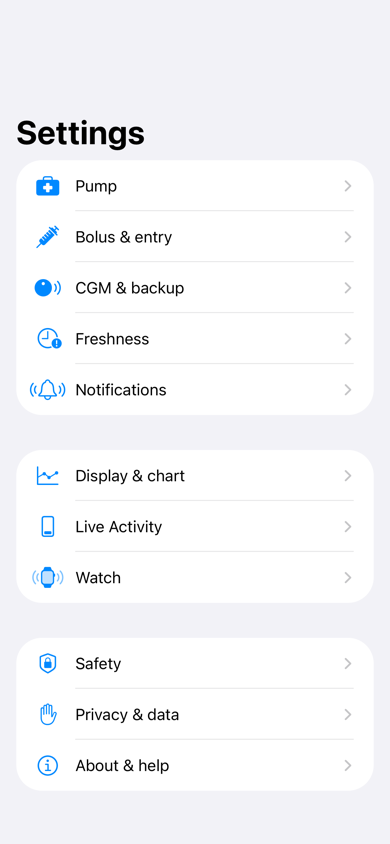
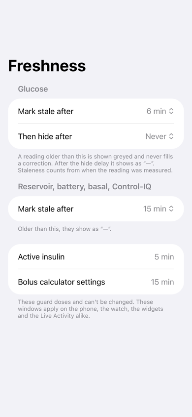
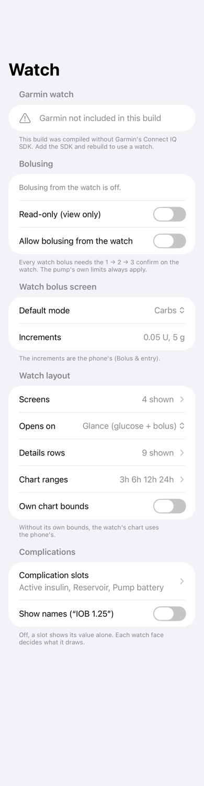

# Settings

<figure class="cx2-shot phone" markdown="span">
  
  <figcaption>Settings, by category</figcaption>
</figure>

## Pump

The paired pump's model, name, status and API version, why the link last dropped, and the history sync.
**Pair a different pump or new code**, **Forget this pump** and **Sync history now** are here. See
[Pair your pump](../setup/pairing.md).

## Bolus & entry

| Setting | Options | Default |
| --- | --- | --- |
| Default mode | Carbs or Units | Carbs |
| Unit increment | 0.05, 0.1, 0.5, 1 or 2 U | 0.05 U |
| Carb increment | 1, 5, 10 or 15 g | 5 g |
| Show the calculation | A breakdown under the suggested dose | On |

The increments are the steps of the bolus screen, on the phone and the watch.

## CGM & backup

The backup glucose source: none, Dexcom Share, Dexcom G6 or Dexcom G7. See [Backup CGM](../setup/cgm.md).

## Freshness {#freshness}

<figure class="cx2-shot phone" markdown="span">
  
  <figcaption>One set of windows for the phone, the watch, widgets and the Live Activity</figcaption>
</figure>

| Setting | Options | Default |
| --- | --- | --- |
| Glucose: mark stale after | 4, 5, 6, 8, 10, 15 or 20 min | 6 min |
| Glucose: then hide after | right away, 5 to 45 min later, or never | Never |
| Reservoir, battery, basal, Control-IQ: mark stale after | 5, 10, 15, 20, 30 or 60 min | 15 min |

A stale glucose is greyed and never fills a correction; after the hide delay it shows as "—". Stale pump
values show as "—". Age counts from when a value was measured.

Two windows guard doses and can't be changed: active insulin expires after **5 minutes** and the pump's
bolus calculator settings after **15 minutes**.

## Notifications

One switch per kind of notification, all on by default, and a delay for **Pump disconnected**. The bolus
result can't be turned off. See [Alerts and notifications](../operate/alerts.md#notifications).

## Display & chart {#display-chart}

- **Chart:** show glucose, the active insulin (IOB) line and bolus bars; the plot's ceiling and floor; and
  unit labels.
- **Statistics card:** time in range, average, GMI and variability over the last day. Off by default.
- **Details rows** and **Dashboard pills:** choose which appear and in what order. Drag to reorder, swipe
  to hide, tap a hidden one to add it back. The **Last auto-correction** row appears once the pump's
  history has one.

Glucose is shown in mg/dL.

## Live Activity

On or off, its style, fields and chart. See [Widgets and Live Activity](../remotes/iphone-widgets.md#live-activity).

## Watch

<figure class="cx2-shot phone" markdown="span">
  
  <figcaption>Settings → Watch</figcaption>
</figure>

| Section | What's there |
| --- | --- |
| **Garmin watch** | The chosen watch and the link's state; **Choose watch in Garmin Connect**; **Get the faBolus watch app** (the Connect IQ Store; not needed when you built the watch app yourself); **Forget watch**. A build without Garmin's SDK says so here. |
| **Bolusing** | **Read-only (view only)**; **Allow bolusing from the watch** (off by default, and it asks you to confirm each time you turn it on); **Limit remote bolus size**, from 1 to 20 U a dose. |
| **Watch bolus screen** | Default mode, Carbs or Units. The increments are the phone's. |
| **Watch layout** | The watch's screens and their swipe order, the screen it opens on, its Details rows, the chart ranges a tap steps through (3, 6, 12, 24 hours), and optional chart bounds of its own. |
| **Complications** | Up to three values besides glucose (active insulin, reservoir, pump battery, basal rate), and whether they show names such as "IOB 1.25". Names are off by default. |

Changes reach the watch at once if it's connected, or the next time it connects. See
[Garmin watch](../remotes/garmin.md).

## Safety {#safety}

**Read-only mode** makes this phone show the pump and CGM but not bolus: the Bolus tab is hidden.
Cancelling a bolus and clearing pump alerts still work. The watch has its own switch under **Watch**.

## Privacy & data

**Delete history on this phone** and **Full reset**. See [Delete data and reset](../operate/erase.md).

## About & help

- **Help & documentation** opens this site.
- **Version** and **Build**, the commit the app was built from. Include them when you report a problem.
- **Export diagnostics**: a text file for debugging, with the pump and watch connection history, the
  pump's identity, alerts and bolus outcomes. It has no pairing code, password or glucose readings.
  Share it only with people you trust.
- **Export Dexcom Bluetooth log**, when the backup is a direct G6 or G7: what the transmitter sent since
  faBolus started. It includes glucose readings and the transmitter's identity.
- The regulatory statement.
