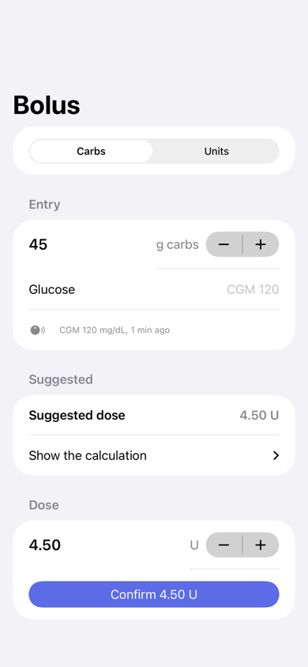

# Bolus and cancel

!!! warning "Check every dose"
    faBolus is experimental and not FDA-cleared. Check the dose before you press Deliver.

<figure class="cx2-shot phone" markdown="span">
  
  <figcaption>Carbs, glucose, the suggested dose, and Confirm</figcaption>
</figure>

## Give a bolus

<ol class="cx2-steps">
<li>Open the <strong>Bolus</strong> tab. It opens in <strong>Carbs</strong> or <strong>Units</strong>, as set in <strong>Settings → Bolus &amp; entry</strong>.</li>
<li><strong>Carbs:</strong> enter the grams. The glucose field shows the current CGM reading; leave it to correct from that reading, or type a fingerprick value in mg/dL. The <strong>Suggested dose</strong> comes from your pump's carb ratio, correction factor, target and active insulin, and the dose below follows it until you change it. <strong>Units:</strong> enter the dose.</li>
<li>Tap <strong>Confirm</strong>.</li>
<li>Check the sheet that opens and tap <strong>Deliver</strong>.</li>
</ol>

The steppers move by your unit and carb increments. **Show the calculation** breaks the suggestion into
carbs, correction and active insulin.

## What happens at Confirm

faBolus reads the pump's bolus settings and active insulin again, then:

- **If a value changed the dose**, it says so and asks whether to use the new dose or keep yours.
- **If the CGM reading is old or missing**, it asks whether to include it or bolus for carbs only. An old
  reading is never used without asking.
- **If the pump's settings couldn't be read fresh**, it asks before using the last ones it has.
- **If a bolus can't be given now**, it says why: for example the pump isn't connected, another bolus is
  running, or an earlier bolus's outcome is unknown.

The last sheet shows the dose, what it's for (carbs, the glucose it corrects from, active insulin), and
any notices above **Deliver**, most important first. For example: the cartridge state wasn't read, or
the dose differs from what the calculator suggests. Nothing is sent until you tap **Deliver**.

The pump's own limits apply: its minimum bolus and the maximum bolus set on the pump.

## While it delivers

The dashboard shows the bolus delivering, then its result: delivered, stopped (with how much went in),
refused by the pump, or not delivered. A notification also tells you the result.

## Cancel {#cancel}

While a bolus delivers, tap **Cancel bolus** on the dashboard. faBolus tells you what happened:

- **Bolus cancelled**;
- **Stopped before anything was delivered**;
- the pump didn't cancel, so the bolus may have finished: check the pump;
- the pump isn't connected or the cancel wasn't confirmed: cancel on the pump.

A cancel is never refused, by read-only mode or anything else. It can wait: for 5 seconds after each
notice from the pump that its communications are suspended, nothing is sent to it, a cancel included
(see [guess 22](../UNVERIFIED-GUESSES.md)). A bolus that ends with less than asked shows as **stopped**,
with the amount the pump reports.

## If the outcome is unknown

If the link drops after a bolus starts, faBolus may not know how much went in. It notifies you at once
and shows a banner, and no new bolus can start, even after a restart, until either:

- the pump's history settles it (faBolus searches it on its own when the pump reconnects), or
- you check the pump's history and tap **I checked the pump**, then **Yes, I checked the pump**. The
  outcome stays unknown in the app until the history settles it, but you can bolus again.

## Carbs recorded on the pump

A carb bolus also sends the carbs, and the glucose it corrects from, to the pump with the bolus, in the
same form Tandem's own app sends them, so the pump records them with the bolus.

## From the watch

The watch can ask for a bolus too. See [Garmin watch](../remotes/garmin.md).
