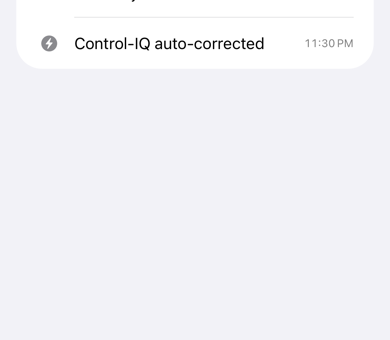

# Logbook

The **Logbook** tab is the pump's history, read from the pump and kept on the phone: boluses, carbs,
glucose entries, basal and temporary rate changes, mode changes, cartridge events, alarms, alerts and
reminders, Control-IQ auto-corrections, and doses the pump couldn't deliver.

<figure class="cx2-shot phone" markdown="span">
  
  <figcaption>Events by day, newest first</figcaption>
</figure>

- Events are grouped by day, newest first. The filter button at the top right shows one kind of event.
- faBolus reads the pump's history every 15 minutes. **Settings → Pump → Sync history now** reads it at
  once.
- The logbook survives restarts. It's emptied when you forget the pump, pair a new one, or delete the
  history in [Privacy & data](erase.md).

Two Control-IQ entries appear under the pump's own names: **Control-IQ auto-bolus rejected**, with no
reason given by the pump, and **Correction declined**, which is you declining the pump calculator's
correction.
