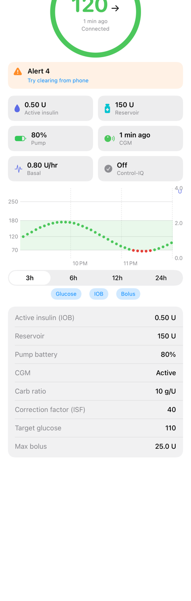

# Dashboard

The app has five tabs: **Dashboard**, **Bolus**, **Alerts**, **Logbook** and **Settings**. The Bolus tab
is hidden in [read-only mode](../customize/settings.md#safety).

<figure class="cx2-shot phone" markdown="span">
  
  <figcaption>Glucose ring, a pump alert, status pills, chart and details</figcaption>
</figure>

## From top to bottom

| Part | What it shows |
| --- | --- |
| **Glucose ring** | The latest glucose with its trend arrow and age, and the pump's link (connected, connecting, disconnected). When a backup CGM supplied the reading, it says "via" that source. |
| **Banners** | Only when they need you: no pump paired, why the link stopped, a connection that keeps dropping, a bolus whose outcome is unknown, notifications turned off, Low Power Mode, a bolus delivering or just finished, and the pump's open alerts. |
| **Cancel bolus** | While a bolus delivers. See [Bolus and cancel](bolus.md#cancel). |
| **Status pills** | By default active insulin, reservoir, pump battery, CGM, basal and Control-IQ. You choose which, and their order. |
| **Chart** | Glucose over 3, 6, 12 or 24 hours, with a 70–180 mg/dL band, optional active insulin (IOB) line and bolus bars. The **Glucose**, **IOB** and **Bolus** buttons under it turn each on or off. |
| **Statistics** | Optional: time in range, average, GMI and variability over the last day. Off by default. |
| **Details** | Active insulin, reservoir, battery, CGM, last bolus, carb ratio, correction factor, target and max bolus, from the pump. Optionally, when Control-IQ last auto-corrected. |

Choose pills, details rows and chart options in
[Settings → Display & chart](../customize/settings.md#display-chart).

## Touch the chart

Touch and drag across the chart to read the time, glucose, active insulin and bolus at that moment. A
value with no sample close to that time shows as "—".

## How old a value is

Every value carries the time it was measured, and the app shows its age.

- **Glucose** older than your stale window (6 minutes unless you change it) is greyed and marked with
  its age. It's never shown as current and never fills a correction. After the hide delay it shows as
  "—".
- **Reservoir, battery, basal and Control-IQ** older than their window (15 minutes by default) show as
  "—".

Set both under [Settings → Freshness](../customize/settings.md#freshness). The watch, the widgets and
the Live Activity use the same windows.

## Low Power Mode

With iOS Low Power Mode on, iOS may delay faBolus's updates in the background. A banner says so while a
pump or CGM is connected. Open faBolus to refresh, or turn Low Power Mode off.

## Next

- [Bolus and cancel](bolus.md)
- [Alerts and notifications](alerts.md)
- [Settings](../customize/settings.md)
