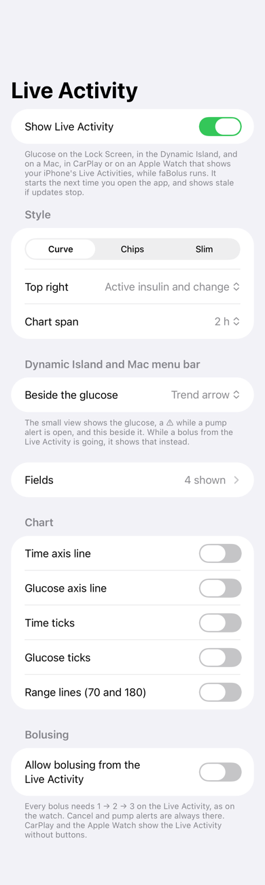

# Widgets and Live Activity

Widgets and the Live Activity show what faBolus last published, with its age. The widgets can't reach the
pump: a tap opens the app. The Live Activity can also bolus, cancel a bolus and clear a pump alert, as the
watch can, if you allow it.

## Widgets

| Widget | Sizes | Shows |
| --- | --- | --- |
| **Glucose** | Lock Screen (inline, circular, rectangular) and small Home Screen | Glucose and trend, from the pump or the backup CGM, and its age. The rectangular one adds active insulin. |
| **Pump overview** | Medium Home Screen | Glucose, active insulin, reservoir and battery. |

To add one, touch and hold the Home Screen or Lock Screen, tap **Edit** (or **Customize** on the Lock
Screen), then **Add Widget**, and choose **faBolus**.

Widgets age their values on their own, with the same [freshness windows](../customize/settings.md#freshness)
as the app: an old glucose is greyed and then hidden, and old pump values show as "—". If faBolus stops
publishing for about 6 minutes, they show that no pump is connected.

## Live Activity

Glucose on the Lock Screen and in the Dynamic Island while faBolus runs, and wherever iOS shows your
iPhone's Live Activities: the Mac's menu bar, CarPlay and the Apple Watch Smart Stack.

<figure class="cx2-shot phone" markdown="span">
  
  <figcaption>Settings → Live Activity</figcaption>
</figure>

Turn it on in **Settings → Live Activity**. It starts the next time you open the app. There you choose:

- **Style**: **Curve** (a full-width glucose curve, with a value of your choice in the top right),
  **Chips** (the number with a grid of values), or **Slim** (one short row). The Mac shows the same card
  when you click its menu-bar pill.
- **Chart span**: 1 to 6 hours. The card's chart button cycles it too.
- **Beside the glucose**: what the Dynamic Island and the Mac's menu-bar pill show next to the glucose:
  the trend arrow, the 30-minute change or active insulin. A ⚠ shows while a pump alert is open, and a
  bolus from the Live Activity shows its progress there instead.
- **Fields**: what it shows, in order, from glucose, active insulin, reservoir, battery, basal,
  Control-IQ, last auto-correction, pump connection (shown when it's down), 30-minute change, time in
  range and last bolus. The Dynamic Island shows the first ones that fit.
- **Chart**: axis lines, ticks, and the 70 and 180 mg/dL range lines.
- **Allow bolusing from the Live Activity**: off until you turn it on. Read-only (for the phone or for
  remotes) turns it off, and the remote bolus limit applies.

### Bolusing from the Live Activity

The steps are the watch's:

1. Tap **Bolus**. iOS asks you to unlock first.
2. Choose **Units** or **Carbs** with the mode button, and set the amount with − and + (by the phone's
   increment) or −1/+1 U, −10/+10 g.
3. Tap **Review**. In carbs mode, a current glucose that changes the dose asks whether to correct, and a
   stale one the calculator may still use asks whether to include it. Each answer names its whole dose.
4. Tap **1**, **2** and **3** in order. A review expires after 90 seconds.
5. If the pump needs a confirmation (too many boluses, the max hourly bolus, low insulin), the Live
   Activity says so: **Go on** takes you back to 1, 2, 3.
6. The result follows: delivering with **Cancel**, then delivered, stopped, not delivered or outcome
   unknown. An unknown outcome blocks new boluses until it's settled, as everywhere else.

**Cancel** shows on the card whenever the pump has a bolus going, from any source, and needs no unlock.
CarPlay and the Apple Watch show the Live Activity without buttons.

### Pump alerts

The card shows the most severe open pump alert and how many there are. Tap it to read them one at a time.
**Clear on pump** appears for an alert the watch could clear. The Live Activity never alerts by itself:
the app's notification is the alert.

### Updates

It updates with each new glucose, and with other values at most once a minute. If updates stop, for
example because faBolus was closed, it greys out as soon as its first value is too old, and old values
show as "—" rather than their last reading.
