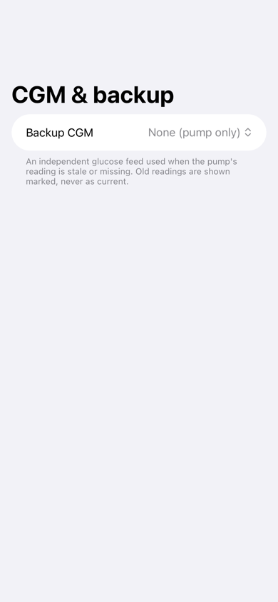

# Backup CGM

Glucose normally comes from the CGM paired with your pump. A backup source gives faBolus a second,
independent feed. It's used only while the pump's own reading is old or missing, and the dashboard
says which source a reading came from.

<figure class="cx2-shot phone" markdown="span">
  
  <figcaption>Settings → CGM &amp; backup</figcaption>
</figure>

Open **Settings → CGM & backup** and choose one **Backup CGM**: **Dexcom Share (cloud)**, **Dexcom G6
(direct Bluetooth)** or **Dexcom G7 (direct Bluetooth)**.

## Dexcom Share

Reads your readings from Dexcom's servers, so it needs an internet connection and Share turned on in
the Dexcom app.

<ol class="cx2-steps">
<li>Choose <strong>Dexcom Share (cloud)</strong>.</li>
<li>Enter the <strong>username</strong> and <strong>password</strong> of the Dexcom account that shares your readings, and your <strong>region</strong>: US, Outside US, or Asia-Pacific (Japan).</li>
<li>Tap <strong>Save and check</strong>.</li>
</ol>

The password is kept in the iPhone's Keychain. To change the account later, enter the new details; leave
the password blank to keep the saved one.

## Dexcom G6 or G7, directly

Reads the sensor over Bluetooth alongside the Dexcom app, on the same iPhone. It works without internet
and is faster than Share. The Dexcom app does the pairing, calibration and sensor changes; faBolus only
listens.

- Keep the **Dexcom app** installed, paired and running in the background.
- **G6:** the transmitter ID is optional. It's printed on the transmitter and shown in the Dexcom app.
  With none typed, faBolus uses the one your pump reports. Tap **Save transmitter ID**, and change it
  when you change the transmitter.
- **G7:** there's nothing to enter. After a sensor change, faBolus finds the new sensor once the Dexcom
  app has paired it.

No Bluetooth pairing prompt should appear for faBolus. If one does, please
[report it](../feedback.md).

## Test it

Tap **Test**. faBolus waits for a reading from the source and shows its value and the time it was
measured. **Status** shows how the source is doing: receiving readings, connected without a recent
reading, or what's wrong.

## How backup readings are used

- A backup reading fills in only while the pump's reading is older than your
  [freshness window](../customize/settings.md#freshness).
- An old reading is greyed and never shown as current, whatever its source.
- If the backup reads an urgent low while the pump's feed is down, faBolus sends one
  "Urgent low (backup CGM)" notification, and withdraws it when the low clears. This works only while
  faBolus is running. Your pump and the Dexcom app keep their own alarms.

!!! note "Helping check the direct G6 and G7 readers"
    While a direct G6 or G7 is the backup, **Settings → About & help → Export Dexcom Bluetooth log** saves
    everything the transmitter sent since faBolus started. It includes glucose readings. It helps when a direct reader misbehaves; see
    [Send feedback](../feedback.md).
